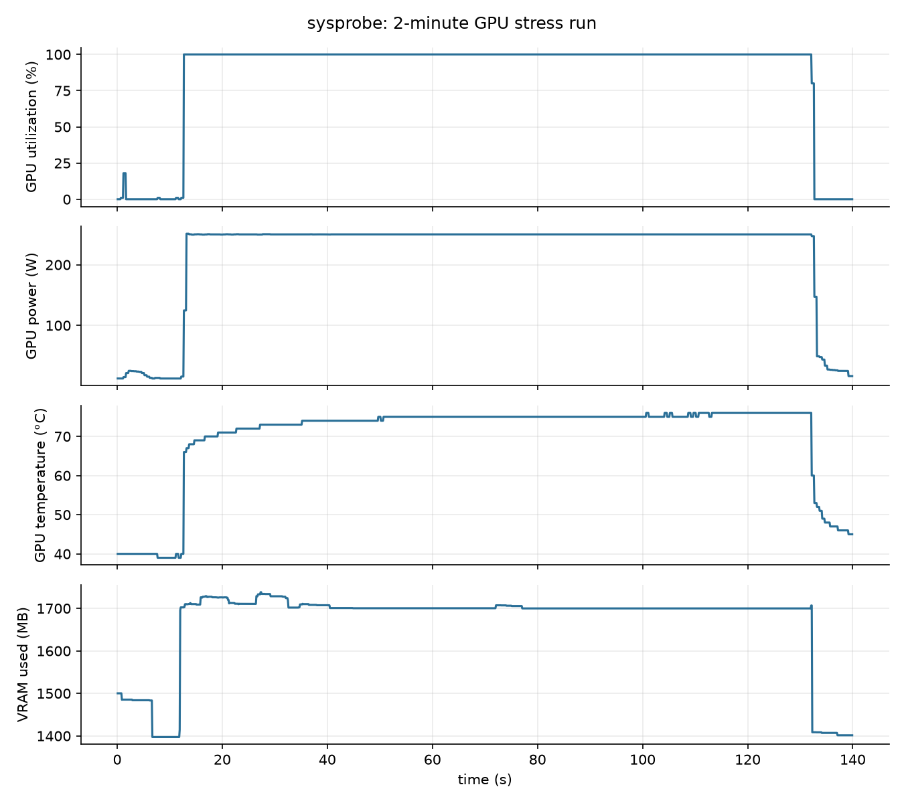

# sysprobe

Samples CPU %, RAM, GPU utilization, VRAM, power and temperature every
100 ms and writes them to a CSV.

## Run
    python sysprobe.py --out results/run.csv --duration 60 --interval 0.1

## Example: 2-minute GPU stress run (RTX 5070)

| Metric | Idle | Under load |
|---|---|---|
| GPU util. | 0 % | 100 % |
| Power | 24 W | 240 W |
| Temp. | 40 °C | 70 °C |
| VRAM | 1400 MB | 1700 MB |

## Notes
- The first row's CPU value is unreliable (psutil needs one prior call).
- Power comes from NVML; it covers the GPU only, not the whole system.
- DataClasses are very useful. Kind of like types and interfaces in javascript.
- pynvml shows you all your gpu metrics
- timing drifts so you have to use tick variable to set duration of time.sleep.